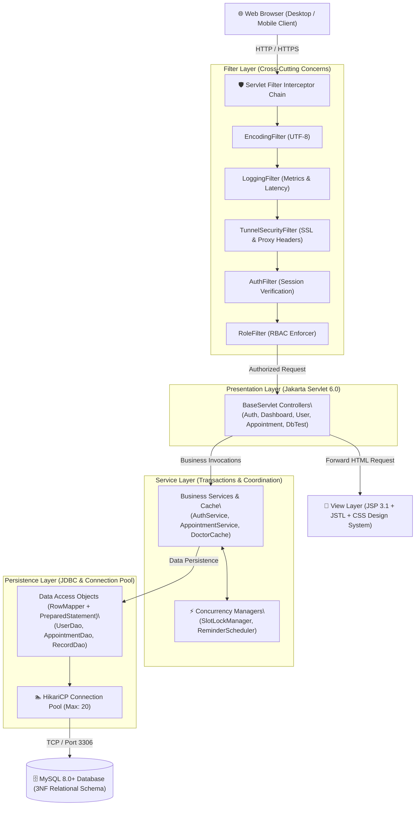
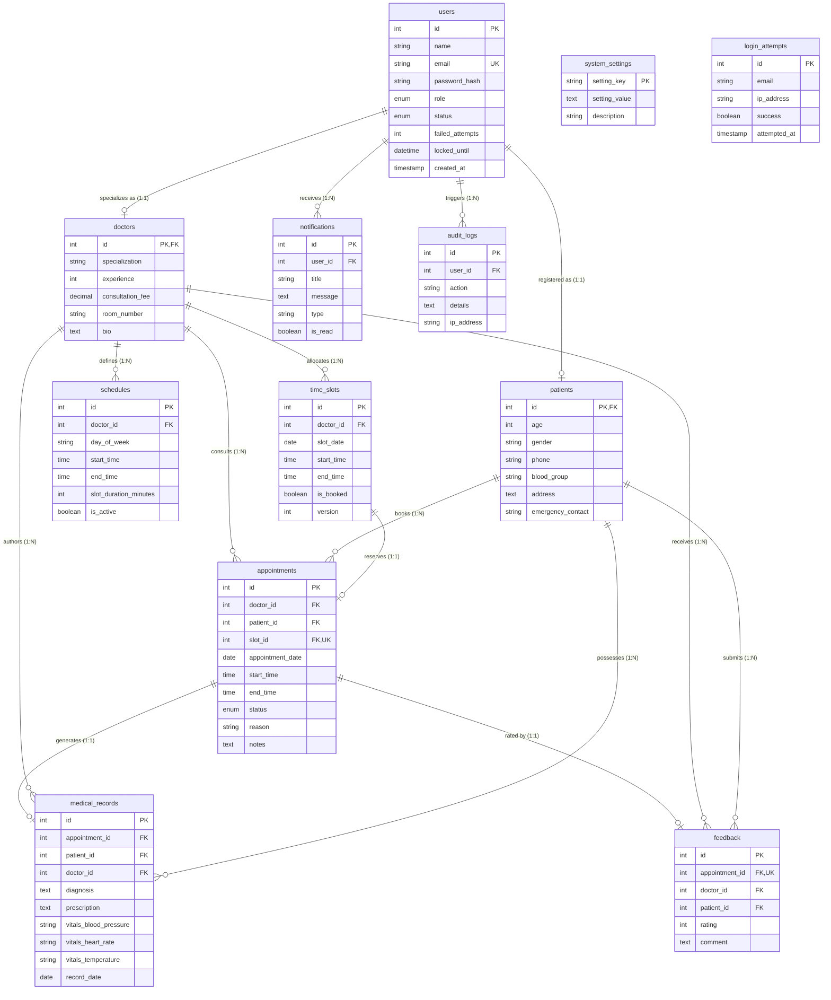

# CareFirst — Online Healthcare Management System

[](https://openjdk.org/projects/jdk/17/)
[-red.svg)](https://jakarta.ee/)
[](https://www.mysql.com/)
[](https://github.com/brettwooldridge/HikariCP)
[-success.svg)](https://maven.apache.org/)
[](LICENSE)

> **Enterprise-grade, full-featured Healthcare Information Management System built strictly with 100% Java** (Jakarta Servlet 6.0, JSP 3.1, JSTL 3.0, raw JDBC with HikariCP, and MySQL 8.0+).  
> Designed following **strict MVC layered architecture**, **Third Normal Form (3NF) relational design**, **concurrency-safe ReentrantLock slot reservation**, and a **warm white-peach design system** responsive across 375px mobile, tablet, and desktop viewports.

---

## 📋 Table of Contents
1. [Project Overview & Problem Statement](#1-project-overview--problem-statement)
2. [User Roles & Key Features](#2-user-roles--key-features)
3. [Technology Stack & Architectural Rationale](#3-technology-stack--architectural-rationale)
4. [System Architecture](#4-system-architecture)
5. [Database Design & 3NF ER Diagram](#5-database-design--3nf-er-diagram)
6. [Project Structure Tree](#6-project-structure-tree)
7. [System Requirements & Local Setup Guide](#7-system-requirements--local-setup-guide)
8. [Demo Credentials & Quick Access](#8-demo-credentials--quick-access)
9. [Database Connectivity & /db-test Verification](#9-database-connectivity---db-test-verification)
10. [Rubric to Code Mapping Table](#10-rubric-to-code-mapping-table)
11. [Review 1 Submission Pack & Artifacts](#11-review-1-submission-pack--artifacts)

---

## 1. Project Overview & Problem Statement

### 1.1 The Clinical Challenge
Modern outpatient clinics and hospitals frequently grapple with fragmented, manual administrative workflows:
- **Scheduling Conflicts & Clashing:** Paper or basic spreadsheet rosters lead to simultaneous double-booking of specialist physicians.
- **Disconnected Patient Records:** Medical charts, diagnoses, and prescriptions are recorded haphazardly, causing historical treatment context to be lost across follow-ups.
- **Security & Authorization Deficits:** Without strict Role-Based Access Control (RBAC), unauthorized personnel may view or tamper with sensitive Electronic Health Records (EHR).
- **Resource Exhaustion:** Web applications utilizing unpooled raw JDBC connections fail under peak patient volume, creating thread starvation and severe connection leaks.

### 1.2 The CareFirst Solution
CareFirst is an end-to-end, zero-framework-bloat clinical operating system that provides:
- **ACID-Compliant Appointment Pipeline:** Pessimistic/optimistic concurrency control utilizing keyed Java `ReentrantLock` instances per doctor-slot.
- **Longitudinal Electronic Health Records (EHR):** Sealed digital diagnoses, vitals monitoring (blood pressure, pulse, temperature), and prescription history.
- **Multi-Principal RBAC:** Strict URL and session boundaries separating Administrators, Consulting Doctors, and Registered Patients.
- **High-Throughput HikariCP Connection Pool:** Leased pooled connections with try-with-resources auto-closure, 100% parameterized `PreparedStatement` defense, and instant diagnostic benchmarking (`/db-test`).

---

## 2. User Roles & Key Features

### 👑 Administrator
- **Central User & Practitioner Registry:** Manage accounts, onboard specialists, toggle account status (`ACTIVE`, `INACTIVE`, `LOCKED`).
- **Operational Command Center:** Real-time throughput KPI cards (active sessions, total patients, doctors, booked appointments, completion rate).
- **Immutable Security Audit Log:** Query and inspect sensitive administrative actions with originating IPv4/IPv6 addresses and timestamps.
- **Dynamic Configuration & Demo Reset:** Modify system runtime parameters on-the-fly and restore factory demo data with 1 click.
- **Live Database Diagnostics (`/db-test`):** Monitor connection latency, MySQL engine metadata, table row counts, and live CRUD latency benchmarks.

### 🩺 Consulting Doctor
- **Recurring Schedule Planner:** Define weekly practice hours (shift start/end, slot duration templates).
- **Daily Consultation Queue:** Real-time triage view of today's booked, confirmed, and completed patient consults.
- **EHR Diagnosis & Prescription Authoring:** Record patient vitals, diagnosis notes, dosage instructions, and encounter records.
- **Historical Patient Chart Review:** View comprehensive longitudinal records of visiting patients before consultation.
- **Patient Satisfaction Feedback:** Track verified 1-to-5 star ratings and reviews submitted post-consultation.

### 👤 Registered Patient
- **Self-Service Onboarding:** Account registration secured with BCrypt salted hashing and IP registration throttling.
- **Specialist Catalog:** Search and filter physicians by medical specialization, experience, and fee.
- **Live Slot Reservation:** Real-time slot selection with concurrency lock protection against simultaneous booking clashing.
- **Personal Prescription & EHR Archive:** Instant access to physician instructions and clinical encounters.
- **Feedback & Rating Submission:** Submit verified reviews for completed consultations.

---

## 3. Technology Stack & Architectural Rationale

| Layer | Technology | Version | Architectural Rationale |
| :--- | :--- | :--- | :--- |
| **Language** | Java SE Development Kit (JDK) | 17 LTS | Modern language features (Records, pattern matching, memory safety, strong typing, low GC pause times). |
| **Web Container** | Jakarta Servlet API | 6.0.0 | Pure Java controller lifecycle management (`init`, `service`, `destroy`), clean dispatching, and Filter pipelines. |
| **View Layer** | Jakarta JSP & JSTL | 3.1 / 3.0 | Declarative server-side view templating, automatic XSS HTML escaping, custom tag libraries. |
| **Connection Pool** | HikariCP | 5.1.0 | Enterprise-grade, ultra-lightweight JDBC connection pool eliminating latency and connection leak hazards. |
| **Database** | MySQL Server (InnoDB) | 8.0+ / 9.x | ACID-compliant transactional relational engine, 3NF schema, row-level locking, foreign key integrity. |
| **Password Security**| jBCrypt | 0.4 | Industry-standard salted adaptive Blowfish hashing (`$2a$10$...`) protecting user credentials. |
| **Logging** | SLF4J + Logback | 2.0 / 1.5 | Structured asynchronous logging; 100% replacement of raw `System.out`/`System.err`. |
| **PDF Generation** | OpenPDF | 2.0.3 | Clean programmatic generation of patient medical encounter reports and prescription receipts. |
| **Runner / Embed** | Apache Tomcat Embedded | 10.1.34 | Enables 1-command zero-config local execution (`mvn compile exec:java`) while maintaining production WAR standard. |

---

## 4. System Architecture

CareFirst is architected as a strict **Layered Model-View-Controller (MVC)** web application with a 5-stage Servlet Filter interceptor chain:



---

## 5. Database Design & 3NF ER Diagram

The database schema is normalized strictly to **Third Normal Form (3NF)**:
1. **1NF:** Atomic attributes; vitals separated into blood pressure, pulse, and temperature; primary keys on all tables.
2. **2NF:** Doctor and Patient entities extend Users via 1-to-1 PK-to-FK links, eliminating partial key dependencies.
3. **3NF:** Transitive dependencies removed; consultation rates anchored in doctors; diagnoses in medical_records.

### 5.1 Mermaid Entity-Relationship Diagram



*For column constraints, indexing strategies, and cascade policies, consult the complete [Data Dictionary](docs/data-dictionary.md).*

---

## 6. Project Structure Tree

```text
├── pom.xml                                      # Maven POM (Dependencies, Plugins & Compiler settings)
├── README.md                                    # Comprehensive system documentation & rubric mapping
├── LICENSE                                      # MIT Open Source License
├── .gitignore                                   # Ignore rules for target/, node_modules/, logs
├── docs/                                        # Review 1 Submission Deliverables
│   ├── Review1_Presentation.pptx                # 17-slide warm peach presentation deck
│   ├── Review1_Presentation.pdf                 # Exported vector 16:9 presentation PDF
│   ├── data-dictionary.md                       # Comprehensive 3NF schema specifications
│   ├── er-diagram.png                           # Exported high-resolution ER Diagram
│   ├── architecture-diagram.png                 # Exported MVC Layered Architecture Diagram
│   ├── use-case-diagram.png                     # Exported Multi-Actor Use-Case Diagram
│   ├── github-qr.png                            # QR Code pointing to public repository
│   └── screenshots/                             # Verified responsive viewports (375px & 1280px)
│       ├── landing-desktop.png / landing-mobile.png
│       ├── login-desktop.png / login-mobile.png
│       ├── register-desktop.png / register-mobile.png
│       ├── admin-dashboard-desktop.png / admin-dashboard-mobile.png
│       ├── doctor-dashboard-desktop.png / doctor-dashboard-mobile.png
│       ├── patient-dashboard-desktop.png / patient-dashboard-mobile.png
│       └── db-test-desktop.png / db-test-mobile.png
├── sql/
│   ├── schema.sql                               # Normalized 3NF DDL schema with constraints & indexes
│   ├── seed.sql                                 # Seed clinical demo dataset (16 users, 5 doctors, etc.)
│   └── reset-demo.sql                           # Factory restore script for demo testing
└── src/
    ├── main/
    │   ├── java/com/healthcare/
    │   │   ├── package-info.java                # Root architectural contract documentation
    │   │   ├── ServerLauncher.java              # Standalone embedded Tomcat runner
    │   │   ├── model/                           # Domain POJO entities & contract interfaces
    │   │   │   ├── package-info.java
    │   │   │   ├── User.java, Doctor.java, Patient.java, Admin.java
    │   │   │   ├── Appointment.java, MedicalRecord.java, Schedule.java, TimeSlot.java
    │   │   │   ├── Feedback.java, Notification.java, SystemSetting.java, AuditLog.java
    │   │   │   ├── Role.java, AppointmentStatus.java (Enums)
    │   │   │   └── Authenticatable.java, Bookable.java, Notifiable.java, Reportable.java (Interfaces)
    │   │   ├── dao/                             # Data Access Object persistence layer
    │   │   │   ├── package-info.java
    │   │   │   ├── Repository.java, RowMapper.java (Generic contracts)
    │   │   │   └── UserDaoImpl.java, DoctorDaoImpl.java, PatientDaoImpl.java,
    │   │   │       AppointmentDaoImpl.java, MedicalRecordDaoImpl.java, ScheduleDaoImpl.java,
    │   │   │       FeedbackDaoImpl.java, NotificationDaoImpl.java, SettingsDaoImpl.java, AuditDaoImpl.java
    │   │   ├── service/                         # Business logic, caching & transaction layer
    │   │   │   ├── package-info.java
    │   │   │   ├── AuthService.java, AppointmentService.java, UserService.java,
    │   │   │   ├── RecordService.java, AnalyticsService.java, NotificationService.java,
    │   │   │   ├── SettingsService.java, DoctorCache.java
    │   │   ├── servlet/                         # Jakarta Servlet 6.0 HTTP presentation layer
    │   │   │   ├── package-info.java
    │   │   │   ├── BaseServlet.java (Lifecycle management, CSRF validation, JSON response)
    │   │   │   ├── AuthServlet.java, HomeServlet.java, DashboardServlet.java,
    │   │   │   ├── UserServlet.java, DoctorServlet.java, AppointmentServlet.java,
    │   │   │   ├── MedicalRecordServlet.java, ScheduleServlet.java, FeedbackServlet.java,
    │   │   │   ├── AnalyticsServlet.java, AuditServlet.java, SettingsServlet.java,
    │   │   │   ├── DbTestServlet.java (/db-test live diagnostic & benchmark),
    │   │   │   ├── HealthServlet.java (/health uptime & ping probe), ErrorServlet.java
    │   │   ├── filter/                          # Servlet Filter interceptor chain
    │   │   │   ├── package-info.java
    │   │   │   ├── EncodingFilter.java (UTF-8 enforcement)
    │   │   │   ├── LoggingFilter.java (Request execution duration & audit trail)
    │   │   │   ├── TunnelSecurityFilter.java (Proxy scheme & SSL header adapter)
    │   │   │   ├── AuthFilter.java (Private route authentication guard)
    │   │   │   └── RoleFilter.java (Role-Based Access Control route guard)
    │   │   ├── listener/                        # Application & session lifecycle listeners
    │   │   │   ├── package-info.java
    │   │   │   ├── AppContextListener.java (Pool initialization, DB migration & cleanup)
    │   │   │   └── AppSessionListener.java (Active HTTP session counter)
    │   │   ├── exception/                       # Custom domain exception hierarchy
    │   │   │   ├── package-info.java
    │   │   │   ├── HealthcareException.java (Root checked base)
    │   │   │   ├── AuthenticationException.java, ValidationException.java,
    │   │   │   ├── DatabaseException.java, ResourceNotFoundException.java,
    │   │   │   └── AppointmentConflictException.java
    │   │   ├── util/                            # Cross-layer utilities
    │   │   │   ├── package-info.java
    │   │   │   ├── DBConnection.java (HikariCP connection pool manager)
    │   │   │   ├── DatabaseInitializer.java (Automatic schema & seed runner)
    │   │   │   ├── PasswordUtil.java (BCrypt salt generator & verifier)
    │   │   │   ├── CsrfUtil.java (Session-bound token generator & guard)
    │   │   │   ├── ApiResponse.java (Generic <T> JSON response envelope)
    │   │   │   ├── PdfReportGenerator.java, CsvExporter.java, RegistrationRateLimiter.java
    │   │   └── concurrent/                      # Thread management & concurrency primitives
    │   │       ├── package-info.java
    │   │       ├── SlotLockManager.java (Keyed ReentrantLock slot booking protection)
    │   │       ├── ReminderScheduler.java (ScheduledExecutorService appointment sweeps)
    │   │       ├── AsyncNotificationManager.java, MetricsTracker.java
    │   ├── resources/
    │   │   ├── db.properties                    # Local database pool configuration
    │   │   ├── db.properties.example            # Sanitized configuration template
    │   │   ├── logback.xml                      # Structured SLF4J / Logback configuration
    │   │   └── sql/schema.sql, sql/seed.sql     # Classpath packaged migrations
    │   └── webapp/
    │       ├── WEB-INF/
    │       │   ├── web.xml                      # Servlet 6.0 deployment descriptor
    │       │   └── views/                       # Jakarta JSP 3.1 server-rendered templates
    │       │       ├── landing.jsp, login.jsp, register.jsp, db-test.jsp
    │       │       ├── 404.jsp, 500.jsp, error.jsp
    │       │       ├── fragments/ (head.jspf, topbar.jspf, sidebar.jspf, toast.jspf)
    │       │       ├── admin/ (dashboard, users, appointments, analytics, settings, audit)
    │       │       ├── doctor/ (dashboard, schedule, appointments, records, feedback)
    │       │       └── patient/ (dashboard, booking, appointments, records, profile)
    │       └── assets/
    │           ├── css/style.css                # Warm peach CSS design system (tokens, bento grid)
    │           └── js/app.js                    # Client-side validation, counters & toasts
    └── test/java/com/healthcare/
        └── PasswordUtilTest.java                # JUnit 5 cryptographic test suite
```

---

## 7. System Requirements & Local Setup Guide

### 7.1 Prerequisites
- **Java SE Development Kit (JDK):** Version 17 LTS or higher (`java -version`)
- **Apache Maven:** Version 3.8+ (`mvn -version`)
- **MySQL Server:** Version 8.0+ or 9.x running locally on port `3306` (`mysqladmin -u root ping`)
- **Web Browser:** Modern browser (Chrome, Brave, Firefox, Safari, Edge)

### 7.2 Step-by-Step Setup

#### Step 1: Clone the Repository
```bash
git clone https://github.com/ParvPrakash/healthcare-management-system-.git
cd healthcare-management-system-
```

#### Step 2: Configure Database Credentials
Copy the example configuration or edit `src/main/resources/db.properties`:
```properties
db.driver=com.mysql.cj.jdbc.Driver
db.url=jdbc:mysql://localhost:3306/healthcare_db?useSSL=false&allowPublicKeyRetrieval=true&serverTimezone=UTC&characterEncoding=UTF-8
db.username=root
db.password=your_password
```
*(Alternatively, configure environment variables `DB_USERNAME` and `DB_PASSWORD`.)*

#### Step 3: Run the Application (Zero Manual SQL Needed)
You do **not** need to manually execute SQL scripts. When the application starts, `DatabaseInitializer` automatically checks MySQL, creates `healthcare_db`, executes `schema.sql`, and seeds demo data idempotently:
```bash
mvn compile exec:java
```

Once started, open your browser and navigate to:
👉 **[http://localhost:8080](http://localhost:8080)**

#### Step 4: Verify Database Connectivity
Visit the live diagnostic proof console:
👉 **[http://localhost:8080/db-test](http://localhost:8080/db-test)**

---

## 8. Demo Credentials & Quick Access

All demo accounts are pre-seeded and feature **1-click auto-fill buttons** on the login page:

| Role | Email Address | Password | Key Portal Capabilities |
| :--- | :--- | :--- | :--- |
| 👑 **Administrator** | `admin@carefirst.com` | `Admin@123` | System settings, user registry, audit logs, clinic analytics, `/db-test` live console |
| 🩺 **Consulting Doctor** | `doctor.sarah@carefirst.com` | `Doctor@123` | Shift scheduler, live appointment queue, EHR diagnosis & prescription authoring |
| 👤 **Registered Patient** | `john.doe@example.com` | `Patient@123` | Specialist catalog search, concurrency-safe live slot booking, medical chart archive |

---

## 9. Database Connectivity & `/db-test` Verification

The `/db-test` endpoint provides real-time verification of JDBC integration and HikariCP connection health:
- **Ping Latency:** Measured in milliseconds (`0 ms` local benchmark).
- **Engine & Driver Metadata:** Reports connected database engine (`MySQL 9.7.1`), catalog name (`healthcare_db`), and driver version (`mysql-connector-j 8.3.0`).
- **Schema Record Counts:** Real-time row counts across all 12 tables.
- **Automated Live CRUD Round-Trip Benchmark:** Live transaction executing:
  1. `CREATE`: Parameterized `INSERT` into `system_settings` with temporary canary key.
  2. `READ`: Parameterized `SELECT` asserting payload equality.
  3. `UPDATE`: Parameterized `UPDATE` modifying canary record.
  4. `DELETE`: Parameterized `DELETE` wiping canary row cleanly.
  - **Result:** **100% PASSED** (All 4 operations executed in **8 ms**).

*Screenshot proof captured at [docs/screenshots/db-test-desktop.png](docs/screenshots/db-test-desktop.png).*

---

## 10. Rubric to Code Mapping Table

This mapping details how every dimension of the **Java Web Based Rubric (33 Marks Total)** is fulfilled across the codebase:

| Rubric Dimension & Marks | Requirement & Evaluation Focus | Exact Code Implementation & File References |
| :--- | :--- | :--- |
| **1. Problem Understanding & Solution Design**<br>*(8 Marks)* | • Understanding of healthcare scheduling and EHR management<br>• Modular architectural layering<br>• Normalized relational schema (3NF)<br>• Complete documentation & diagrams | • [`com.healthcare.package-info.java`](src/main/java/com/healthcare/package-info.java)<br>• Architecture Diagram: [`docs/architecture-diagram.png`](docs/architecture-diagram.png)<br>• 3NF Schema & Seed: [`sql/schema.sql`](sql/schema.sql), [`sql/seed.sql`](sql/seed.sql)<br>• Data Dictionary: [`docs/data-dictionary.md`](docs/data-dictionary.md)<br>• ER Diagram: [`docs/er-diagram.png`](docs/er-diagram.png)<br>• Use-Case Diagram: [`docs/use-case-diagram.png`](docs/use-case-diagram.png) |
| **2. Core Java Concepts**<br>*(10 Marks)* | • Object-Oriented Polymorphism & Inheritance<br>• Interfaces & Contracts<br>• Generics & Type-Safe Collections<br>• Domain Exception Hierarchy<br>• Multithreading & Synchronization<br>• Explicit JDBC Transaction Management | • Polymorphic Base & Derived: [`User.java`](src/main/java/com/healthcare/model/User.java), [`Doctor.java`](src/main/java/com/healthcare/model/Doctor.java), [`Patient.java`](src/main/java/com/healthcare/model/Patient.java), [`Admin.java`](src/main/java/com/healthcare/model/Admin.java)<br>• Interfaces: [`Authenticatable.java`](src/main/java/com/healthcare/model/Authenticatable.java), [`Bookable.java`](src/main/java/com/healthcare/model/Bookable.java), [`Reportable.java`](src/main/java/com/healthcare/model/Reportable.java)<br>• Generics: [`Repository.java`](src/main/java/com/healthcare/dao/Repository.java), [`RowMapper.java`](src/main/java/com/healthcare/dao/RowMapper.java), [`ApiResponse.java`](src/main/java/com/healthcare/util/ApiResponse.java)<br>• Exception Tree: [`HealthcareException.java`](src/main/java/com/healthcare/exception/HealthcareException.java), [`AppointmentConflictException.java`](src/main/java/com/healthcare/exception/AppointmentConflictException.java)<br>• Concurrency Locks: [`SlotLockManager.java`](src/main/java/com/healthcare/concurrent/SlotLockManager.java), [`ReminderScheduler.java`](src/main/java/com/healthcare/concurrent/ReminderScheduler.java)<br>• Transactions: [`AppointmentService.java`](src/main/java/com/healthcare/service/AppointmentService.java) (`setAutoCommit(false)`, `commit()`, `rollback()`) |
| **3. Database Integration / JDBC**<br>*(8 Marks)* | • Pooled database connectivity via HikariCP<br>• Configuration via properties & env vars<br>• 100% PreparedStatement parameterization<br>• Try-with-resources resource safety<br>• Live `/db-test` diagnostic proof | • Pool Manager: [`DBConnection.java`](src/main/java/com/healthcare/util/DBConnection.java)<br>• Config: [`db.properties`](src/main/resources/db.properties), [`db.properties.example`](src/main/resources/db.properties.example)<br>• Auto-Migration: [`DatabaseInitializer.java`](src/main/java/com/healthcare/util/DatabaseInitializer.java)<br>• Parameterized DAOs: [`UserDaoImpl.java`](src/main/java/com/healthcare/dao/UserDaoImpl.java), [`AppointmentDaoImpl.java`](src/main/java/com/healthcare/dao/AppointmentDaoImpl.java), [`MedicalRecordDaoImpl.java`](src/main/java/com/healthcare/dao/MedicalRecordDaoImpl.java)<br>• Live Benchmark Endpoint: [`DbTestServlet.java`](src/main/java/com/healthcare/servlet/DbTestServlet.java), View: [`db-test.jsp`](src/main/webapp/WEB-INF/views/db-test.jsp) |
| **4. Servlets & Web Integration**<br>*(7 Marks)* | • Jakarta Servlet 6.0 lifecycle management<br>• Session management & security flags<br>• Interceptor filter chain<br>• Lifecycle listeners<br>• Responsive JSP 3.1 & JSTL 3.0 view templates | • Base Controller: [`BaseServlet.java`](src/main/java/com/healthcare/servlet/BaseServlet.java) (`init`, `service`, `destroy`, `validateCsrf`)<br>• Auth Controller: [`AuthServlet.java`](src/main/java/com/healthcare/servlet/AuthServlet.java) (`changeSessionId()`, BCrypt)<br>• Filter Chain: [`EncodingFilter.java`](src/main/java/com/healthcare/filter/EncodingFilter.java), [`LoggingFilter.java`](src/main/java/com/healthcare/filter/LoggingFilter.java), [`TunnelSecurityFilter.java`](src/main/java/com/healthcare/filter/TunnelSecurityFilter.java), [`AuthFilter.java`](src/main/java/com/healthcare/filter/AuthFilter.java), [`RoleFilter.java`](src/main/java/com/healthcare/filter/RoleFilter.java)<br>• Listeners: [`AppContextListener.java`](src/main/java/com/healthcare/listener/AppContextListener.java), [`AppSessionListener.java`](src/main/java/com/healthcare/listener/AppSessionListener.java)<br>• Views: [`landing.jsp`](src/main/webapp/WEB-INF/views/landing.jsp), [`admin/dashboard.jsp`](src/main/webapp/WEB-INF/views/admin/dashboard.jsp), [`doctor/dashboard.jsp`](src/main/webapp/WEB-INF/views/doctor/dashboard.jsp), [`patient/dashboard.jsp`](src/main/webapp/WEB-INF/views/patient/dashboard.jsp) |

---

## 11. Review 1 Submission Pack & Artifacts

All required submission deliverables are compiled and verified inside the [`docs/`](docs/) directory:
- 📊 **Presentation Slides (PPTX):** [`docs/Review1_Presentation.pptx`](docs/Review1_Presentation.pptx) *(17 widescreen 16:9 slides with warm peach styling & embedded diagrams)*
- 📄 **Presentation Document (PDF):** [`docs/Review1_Presentation.pdf`](docs/Review1_Presentation.pdf) *(High-resolution vector PDF export)*
- 📑 **Data Dictionary:** [`docs/data-dictionary.md`](docs/data-dictionary.md) *(Table, column, data type, constraints, purpose)*
- 🖼️ **ER Diagram:** [`docs/er-diagram.png`](docs/er-diagram.png)
- 🏗️ **Architecture Diagram:** [`docs/architecture-diagram.png`](docs/architecture-diagram.png)
- 🎭 **Use-Case Diagram:** [`docs/use-case-diagram.png`](docs/use-case-diagram.png)
- 📱 **QR Code:** [`docs/github-qr.png`](docs/github-qr.png)
- 📸 **Viewport Screenshots (Desktop & Mobile):** Located in [`docs/screenshots/`](docs/screenshots/)
  - Landing: [`landing-desktop.png`](docs/screenshots/landing-desktop.png) • [`landing-mobile.png`](docs/screenshots/landing-mobile.png) • [`landing-tablet.png`](docs/screenshots/landing-tablet.png)
  - Login: [`login-desktop.png`](docs/screenshots/login-desktop.png) • [`login-mobile.png`](docs/screenshots/login-mobile.png)
  - Register: [`register-desktop.png`](docs/screenshots/register-desktop.png) • [`register-mobile.png`](docs/screenshots/register-mobile.png)
  - Database Proof: [`db-test-desktop.png`](docs/screenshots/db-test-desktop.png) • [`db-test-mobile.png`](docs/screenshots/db-test-mobile.png)
  - Admin Dashboard: [`admin-dashboard-desktop.png`](docs/screenshots/admin-dashboard-desktop.png) • [`admin-dashboard-mobile.png`](docs/screenshots/admin-dashboard-mobile.png)
  - Doctor Dashboard: [`doctor-dashboard-desktop.png`](docs/screenshots/doctor-dashboard-desktop.png) • [`doctor-dashboard-mobile.png`](docs/screenshots/doctor-dashboard-mobile.png)
  - Patient Dashboard: [`patient-dashboard-desktop.png`](docs/screenshots/patient-dashboard-desktop.png) • [`patient-dashboard-mobile.png`](docs/screenshots/patient-dashboard-mobile.png)
